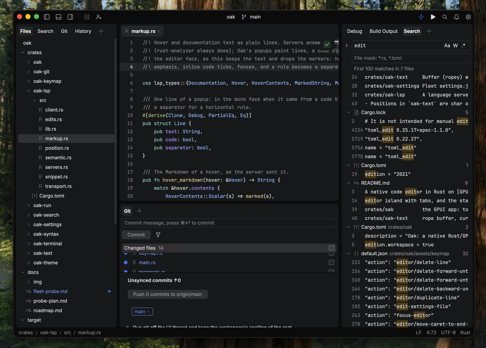

<p align="center">
  
</p>

<h1 align="center">WEEP</h1>

<p align="center"><strong>Fleet's shape, native.</strong></p>

<p align="center">
  
  
  
  
</p>

<p align="center">
  <a href="#status">Status</a> ·
  <a href="#the-window">The window</a> ·
  <a href="#the-editor">Editor</a> ·
  <a href="#the-tools">Tools</a> ·
  <a href="#smart-mode">Smart Mode</a> ·
  <a href="#measured-against-fleet">Measured</a> ·
  <a href="#build-and-run">Build</a> ·
  <a href="#roadmap">Roadmap</a> ·
  <a href="https://weep.cc">Manual</a>
</p>

WEEP is a native code editor written in Rust on [GPUI](https://gpui.rs), built to look and
behave like [JetBrains Fleet](https://www.jetbrains.com/fleet/): the islands layout, the
Files, Search, Git, Terminal and Run tools, Fleet's own theme, keymap and settings files
loaded unchanged, and every size and color read off a running copy rather than guessed at.
No JVM, no account, no telemetry. It is an independent project and is not affiliated with
JetBrains.



*WEEP on its own source: the Files tree with git status, a Rust file in the editor, the Git
tool docked below with its commit field and changed files, and find-in-files results on the
right — Fleet's islands at Fleet's sizes, in Fleet Dark's colors, on macOS.*

## Status

Milestones M0 to M6 built, M7 in progress. WEEP clones Fleet 1.48 as it behaves without
Smart Mode first — the shell, the editor, Files, Goto, Search, Git, Terminal, Run, Settings,
themes and keymaps — and then adds Smart Mode through language servers in place of Fleet's
IntelliJ backend. The first Smart Mode pass is in, through rust-analyzer, which is also
what Fleet's own Rust Smart Mode runs. Against the tables Fleet 1.48.261 ships, WEEP binds
145 of its 203 default-chord action ids, reads 104 of its 430 `settings.json` keys and
paints 199 of its 684 theme color keys.

> **Keep your work in version control.** WEEP is v0.1.0, a first pre-release. It saves
> files in place and autosaves by default, as Fleet does; many sizes on the newest surfaces
> are still estimates until their probe scenes run against Fleet.

## The window

Fleet's frame: a toolbar along the top, the editor island in the middle, and left, bottom
and right panels around it, each an island with its own tab row of tools, draggable
splitters and remembered widths. Editor tabs with preview tabs, drag to reorder and Fleet's
close commands; splits that share one document per file, each view keeping its own carets,
folds and scroll. `zoomLevel` scales every metric by one factor. On Windows WEEP draws
Fleet's own caption; elsewhere it keeps the desktop's title bar, as Fleet does.

## The editor

Everything Fleet does to a plain text file: multiple carets (add above and below, select
next and all occurrences, Alt+click), find and replace with case, word and regex toggles,
folding with the gutter chevrons and sticky lines, expand and shrink selection, bracket
matching, indent guides, soft wrap, the indenter and auto-pairs, `.editorconfig`, trailing
space trimming, autosave, line-ending and case commands, and paste from history.
Highlighting is tree-sitter (Rust, JSON, TOML, Markdown) mapped onto Fleet's
`textAttributes` keys, so a Fleet theme colors it unchanged.

## The tools

- **Goto** — Fleet's popup with its Goto, Actions, Tools and Text Search tabs and a preview
  under the list: files, symbols, every action with its chord, recent files and workspaces.
- **Text Search** — find and replace across the workspace with Fleet's query fields, through
  open documents and on disk; the Search tool shows the same results as a tree.
- **Files** — compact folders, git status, multi-select, drag and drop, hidden files,
  inline rename, the right-click menu and Fleet's keyboard highlight mode.
- **Git and History** — status in the tree and the gutter, staging and commit, unsynced
  commits with Push, history, blame, the side-by-side Changed Files tab with staging and
  Revert, pull, fetch and the branch menu.
- **Terminal** — a shell on a real PTY through `alacritty_terminal`, with Fleet's
  `terminal.profiles`, in tabs.
- **Run** — `.fleet/run.json` in Fleet's format, the gutter's run icons, a Run tab per
  configuration with its output, and the problems widget.
- **Settings** — Fleet's Settings pages as an editor tab, every row bound to its key and
  writing your `settings.json`. Menus, confirm dialogs, toasts and the Notifications popup
  are Fleet's too.

## Smart Mode

The lightning in the toolbar attaches a language server — rust-analyzer today, found on
`PATH` or through rustup. With it on: diagnostics and quick fixes in the problems widget,
semantic highlighting over tree-sitter's, completion with additional edits and snippets,
parameter info, documentation on hover, go to declaration and type declaration, find
usages, back and forward, rename across files, optimize imports, reformat and format on
save. Inlay hints, code vision, the inline rename and other languages' servers are still
ahead; the debugger over DAP is M8.

## Measured against Fleet

Fleet is the reference, and "looks like Fleet" is measured rather than felt. A probe scene
is played into Fleet and into WEEP with real input, both are captured at the same zoom, and
`tools/fleet-probe/compare.py` holds every island, tab-row and status-bar edge to within one
logical pixel and every color to the theme's exact value. Every size lives in one table
(`metrics` in `crates/weep/src/theme.rs`), and `docs/fleet-probe.md` records where each
value came from or marks it as an estimate. `tools/fleet-probe/inventory.py` and
`coverage.py` count what Fleet ships and how much of it WEEP covers.

Fleet's file formats are WEEP's: themes, keymaps and settings use Fleet's keys and action ids
verbatim, so Fleet files load unchanged, and WEEP falls back to Fleet's own `settings.json` so
an existing setup carries over. The work is clean room on the binary — nothing from the
Fleet distribution ships except the openly licensed fonts.

| Fleet | WEEP |
| --- | --- |
| TextMate grammars | tree-sitter, mapped onto the same `textAttributes` keys |
| The IntelliJ backend | LSP and DAP servers; the lightning and its states stay Fleet's |
| A Chromium (JCEF) Markdown preview | Markdown painted natively |
| JVM, account, telemetry | None of them |

## Download and build

The [latest release](https://github.com/ragtux/WEEP/releases/latest) carries an archive per
platform — `linux-x64.tar.gz`, `macos-universal.zip`, `windows-x64.zip` — each with its
`.sha256`. Nothing is signed; on macOS the first launch needs right-click > Open. From
source:

```
cargo run --release -p weep -- <folder-or-file>
cargo run --release -p weep -- --theme dark_purple --zoom 1.5 <folder-or-file>
nix-shell --run 'cargo run --release -p weep -- <folder-or-file>'   # NixOS: X11, Wayland and Vulkan
cargo test --workspace --exclude weep                               # the library crates, no GPU needed
```

A stable toolchain (1.85+) builds it on Linux (with a Vulkan driver), on Windows with the
MSVC Build Tools, and on macOS with Xcode's command line tools. When the repository sits on
a network share or volume, point `CARGO_TARGET_DIR` at a local disk.

## Packaging

One script per platform builds the release archive into `dist/`, each with the binary and
the licenses of what it bundles:

| Platform | Command | Archive |
| --- | --- | --- |
| Linux | `tools/linux/package.sh` (`just package-linux`) | `weep-<version>-linux-x64.tar.gz`, with the `.desktop` entry and its icon |
| macOS | `tools/macos/package.sh` (`just package-macos`) | `weep-<version>-macos-universal.zip`, a `WEEP.app` for both arches |
| Windows | `pwsh tools/windows/package.ps1` (`just package-windows`) | `weep-<version>-windows-x64.zip` |

`.github/workflows/release.yml` runs the three on a `v*` tag and attaches the archives,
with their `.sha256` files, to the release; Linux is built on Ubuntu 22.04, so the tarball
needs that glibc or newer. Nothing is signed or notarized: on macOS the first launch needs
right-click > Open.

On Windows a release build is a GUI program with its icon and version resource
(`crates/weep/build.rs`) and a static C runtime (`.cargo/config.toml`), so it needs no
Visual C++ Redistributable; started from a terminal it still prints `--help` and its
diagnostics there.

`weep --theme dark|dark_purple|light` picks a bundled theme; `--theme path.json` loads any
Fleet-format theme, including one from `~/.config/JetBrains/Fleet/themes`. Settings come
from `~/.config/weep/settings.json` (`%APPDATA%\weep` on Windows) over Fleet's own file;
`WEEP_CONFIG_DIR` relocates WEEP's folder. Keys follow Fleet's defaults
(`crates/weep/assets/keymap/default.json`, in Fleet's keymap format);
`~/.config/weep/keymap.json` overrides them, and the `keymap` setting loads a Fleet preset
from `~/.config/weep/keymaps/`. `weep --help` prints every flag.

## Crates

| Crate | Responsibility |
| --- | --- |
| `weep` | The GPUI app: the window, panels, tabs, the editor element and every tool |
| `weep-text` | Rope buffer with an edit log, carets and selections, undo, every edit command, search (no gpui) |
| `weep-syntax` | tree-sitter highlighting onto Fleet's `textAttributes` keys, folds, brackets, symbols (no gpui) |
| `weep-theme` | Fleet theme JSON: palette resolution and cascading attribute lookup |
| `weep-keymap` | Fleet keymap JSON: per-platform chords and their gpui spelling |
| `weep-settings` | Fleet `settings.json` layered over Fleet's own, `.editorconfig`, a change watcher |
| `weep-search` | The Goto matcher, the file index, find and replace in files |
| `weep-git` | Git through the `git` binary: status, staging, history, blame, diffs, push and pull |
| `weep-terminal` | A shell on a PTY through `alacritty_terminal` |
| `weep-run` | Fleet's `.fleet/run.json` and the processes it starts |
| `weep-lsp` | A language server on its pipes: transport, requests, positions, edits, semantic tokens |

Every crate but `weep` is free of gpui and tested on its own — git, the terminal and run
against the real binaries, and `weep-lsp` against a real rust-analyzer.

## Roadmap

| Milestone | Covers | Status |
| --- | --- | --- |
| M0 Scaffold | Toolbar, Files, editor, status bar, Fleet's theme and keymap formats | Done |
| M1 Shell fidelity | Zoom, panels, tabs, splits, tooltips, scrollbars, live settings | Done |
| M2 Editor core | Carets, find and replace, folding, wrap, the indenter, autosave | Built; three scenes still to run on Fleet |
| M3 Workbench tools | Goto, Text Search, Files, menus, dialogs, notifications, Settings | Built |
| M4 Git | Status, gutter, Git and History tools, blame, Changed Files, push and pull | Built |
| M5 Terminal | PTY tabs, Fleet's profiles | Built |
| M6 Run and problems | `.fleet/run.json`, the Run tool, the problems widget | Built |
| M7 Smart Mode via LSP | Diagnostics, completion, navigation, rename, quick fixes, formatting | First pass built |
| M8 Debugger via DAP | Breakpoints, the debug tools | Not started |

The milestones, what each covers and what is left in each live in `docs/roadmap.md`; how Fleet
is probed is `docs/probe-plan.md`. The manual is published at [weep.cc](https://weep.cc),
built from `site/` in this repository.

## Licenses

WEEP is MIT; see [LICENSE](LICENSE). It bundles Inter and JetBrains Mono (SIL OFL) and icons
from JetBrains' IntelliJ Platform `expui` set (Apache 2.0, header in every file); WEEP's own
icons are MIT. The bundled themes are value tables in Fleet's file format carrying the colors
Fleet 1.48 renders with; see `docs/fleet-probe.md`. JetBrains and Fleet are trademarks of
JetBrains s.r.o.
